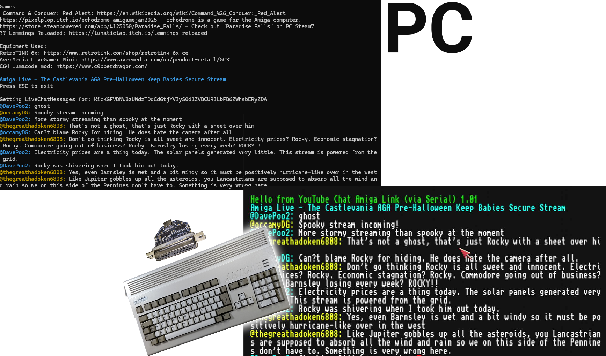

# YouTubeChatAmigaLink

PC C#/.Net project to send YouTube chat messages to an Amiga via serial link, where they can be displayed by [NComm](https://aminet.net/package/comm/term/ncomm309).

# Repository Contents
* [YouTubeAmigaChat.cs](YouTubeAmigaChat.cs) - The C#/.Net program that runs on the PC to set YouTube chat messages to the Amiga
* [Amiga/NComm/speak.script](Amiga/NComm/speak.script) - The NComm script to allow the YouTube chat to be read out by Amiga say command
* [Amiga/CLI/getspeak](Amiga/CLI/getspeak) - Amiga CLI script to copy say command from older workbench to newer workbench (it was removed in later versions)
* [Amiga/NComm/Doc](Amiga/NComm/Doc) - The NComm 3.0 docs, as they aren't availabe to read on the internet unless you unpack the lha from Aminet
* [Amiga/NComm/Scripts](Amiga/NComm/Scripts) - The NComm 3.0 example scripts, here for reference

# YouTubeAmigaChat.cs

This is the main program that runs on the PC, it connects to the YouTube API and retreives chat messages, reformats them, and then sends them via the serial port to the Amiga.

* Converts the chat into extended ASCII so it can be displayed on the Amiga reasonably well.
* Converts Emojis into text because the Amiga can't display them
* YouTube chat can use commands starting with / to create ANSI escape codes .e.g. /r red text /b blue text
* /say command uses a script in Ncomm to launch amiga say and speak the text following /say. e.g. /say hello, would cause the amgia to speak "hello" out loud if the ncomm script was running.
* Tested with [Amiga DiagROM Amiga DB25 Serial Port Output Debug Adapter for PC Type C](https://www.ebay.co.uk/itm/127118641849), search www.eBay.co.uk for the listing.

## Uses Frameworks:
* Google.Apis.Auth
* Google.Apis.YouTube.v3
* EmojiToText

# Getting the Amiga to "say" Chat messages (optional)

## Amiga/NComm/speak.script

This is the NComm script used to get NComm to speak Amiga say commands.

## Amiga/CLI/getspeak

Amiga OS 3.0 and later didn't come with the say program. 

This is the Amiga CLI script I used to copy say program from a workbench 2.0 disk onto an Amiga 1200 with Amiga OS 3.2

# Links

* NComm 3.09 (Updated 22nd October 2026) - https://aminet.net/package/comm/term/ncomm309
* NComm 3.0 (1993 release, lha contains the scripting docs etc) - https://aminet.net/package/comm/term/ncomm30
* ANSI Escape Sequences - https://gist.github.com/fnky/458719343aabd01cfb17a3a4f7296797
* DiagROM USB to DB25 Adaptor - https://www.ebay.co.uk/itm/127118641849